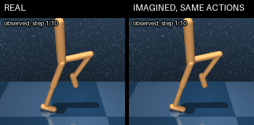
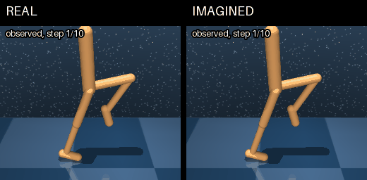
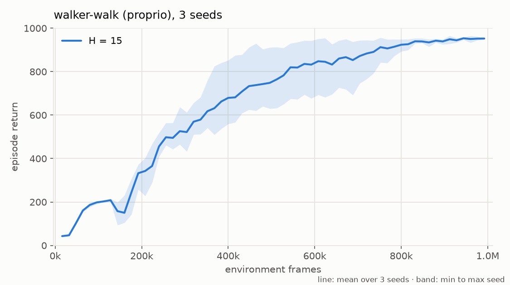
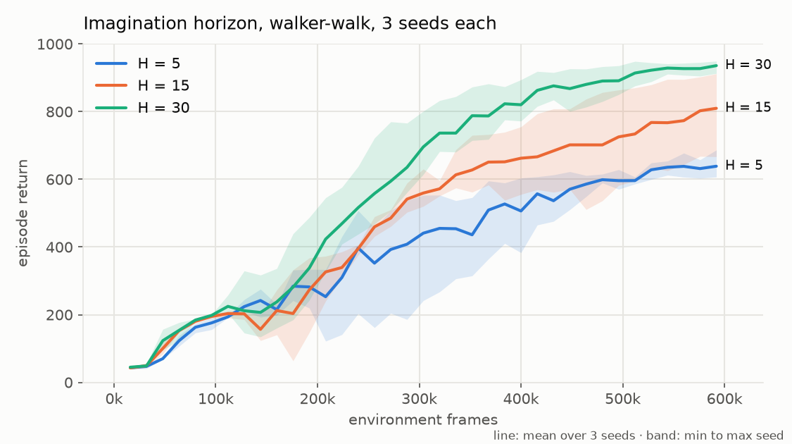

# adam-dreamer-torch

A from-scratch PyTorch reproduction of DreamerV3 ([Hafner et al., arXiv 2301.04104, rev. 2](https://arxiv.org/abs/2301.04104)) on DeepMind Control, continuous actions. The world model, actor-critic, losses, replay buffer and training loop are my own implementation; only the DeepMind Control env wrapper is adapted from [NM512/dreamerv3-torch](https://github.com/NM512/dreamerv3-torch).



Left: the real walker in the simulator. Right: after the same few real context steps, the world model continues on its own, fed the actions the policy took in the simulator but no new observations. It tracks the real walker at first, then falls: the walker is unstable without feedback, so small prediction errors grow. The model predicts the 24-number proprio state, not pixels, so each dreamed state is decoded and drawn as a walker pose in MuJoCo ([`scripts/dream_gif.py`](scripts/dream_gif.py)).



Same start, but now the actor chooses its own actions inside the dream, as it does during training in imagination. The left side is the same policy acting in the simulator. Both walk, but the two sides are not expected to match pose for pose: each one's actions respond to its own states.

## Results

All results are on walker-walk with proprioceptive observations. Curves show env frames on the x axis (agent steps × action repeat 2). Each line is the mean over 3 seeds, and the shaded band spans the lowest to the highest seed. "Final return" is the mean of each seed's last 48 episodes (its last 3 batches of 16 parallel envs); the ± is the standard deviation over the 3 seeds. Figures and tables are generated by [`scripts/plot_results.py`](scripts/plot_results.py) from the per-episode returns in `results/`. Training curves for every run (losses, entropy, return scale and more) are in the [W&B report](https://forge.coreweave.com/wandb/adamthorne91-personal/adam-dreamer-torch/reports/DreamerV3-from-scratch-walker-walk-training-runs--VmlldzoxODMwMjc3MA).

### walker-walk, 3 seeds

500k agent steps per seed (1M env frames), H = 15.



| Read at | Agent steps | Env frames | Seed 0 | Seed 1 | Seed 2 | Mean ± std |
|---|---|---|---|---|---|---|
| end of run | 500k | 1M | 942.2 | 952.3 | 960.2 | 951.6 ± 7.4 |
| paper budget | 250k | 500k | 630.2 | 684.4 | 914.8 | 743.2 ± 123.4 |

These runs used commit `5889b17` (`results/walker_walk_v1/run_info.txt`), which predates the action clipping inside the dynamics (`4df6bb5`; see [Differences](#differences-from-the-paper-and-the-official-code)).

**Published DreamerV3.** The paper's Proprio Control benchmark has a budget of 500K environment steps. The official repository publishes per-task score curves ([`scores/dmc_proprio-dreamerv3.json.gz`](https://github.com/danijar/dreamerv3/tree/main/scores)): for walker-walk, 5 seeds, logged every 10K steps up to 490K. Averaging each seed's last 3 logged points (470K–490K):

| Run | Seeds | Budget | Final return, mean ± std |
|---|---|---|---|
| DreamerV3, official scores | 5 | 500K env steps | 935.8 ± 25.9 (per seed: 968.5, 952.1, 891.0, 934.2, 933.0) |
| This repo, read at 500k env frames | 3 | 500k env frames | 743.2 ± 123.4 |
| This repo, end of run | 3 | 1M env frames | 951.6 ± 7.4 |

The paper reports 936 for walker-walk at 500K steps (Table 11). Its environment steps count frames after action repeat (e.g. Atari100k is "400K env steps, 100K after action repeat"), so the 500k-frame row is the like-for-like comparison: at the paper's budget this repo is behind on average (one seed matches, two are still climbing) and catches up by 1M frames. The official numbers are single logged values every 10K steps and are noisy (single-point values at 490K range from 736 to 955), so the average of the last few points is used.

### Imagination horizon ablation

H ∈ {5, 15, 30}, 3 seeds each, **300k agent steps per run (600k env frames)**, compared with 500k agent steps for the runs above. With action repeat 2, H = 5, 15 and 30 imagine 10, 30 and 60 simulator steps ahead.



| Horizon | Seed 0 | Seed 1 | Seed 2 | Mean ± std |
|---|---|---|---|---|
| H = 5 | 674.0 | 624.0 | 610.7 | 636.2 ± 27.2 |
| H = 15 | 659.5 | 822.9 | 903.2 | 795.2 ± 101.4 |
| H = 30 | 945.9 | 908.4 | 935.8 | 930.1 ± 15.8 |

All 9 runs reached 300k agent steps. The H = 15 row is not directly comparable to the 3-seed table above: it trained for 600k frames instead of 1M, and with a later version of the code (commit `4aa0e6c`, which includes the action clipping).

Longer horizons learned faster and more reliably. Every H = 30 seed passed a batch-mean return of 800 by 208k agent steps (at 152k, 192k and 208k). Two H = 15 seeds passed it later (216k, 288k) and the third had not by 300k. No H = 5 seed passed it; their best batch mean was 687. The critic bootstraps beyond the horizon in every case ($R_H = v_H$), so the shorter horizons still see a value estimate of what follows. But at H = 5 the actor's return is built from only 10 simulator steps, about 0.25 s, which is too short to show where a stride leads. Up to H = 30, longer rollouts showed no cost from compounding model error.

## Reproduce

Requires Python 3.12 and [uv](https://docs.astral.sh/uv/).

```bash
git clone https://github.com/athorneak13/adam-dreamer-torch.git
cd adam-dreamer-torch
uv sync
uv run pytest            # 106 unit tests
```

Train walker-walk (one seed):

```bash
uv run python -m src.train --config configs/dmc_walker_walk.yaml --seed 0
```

The config sets `device: cuda` and logs to Weights & Biases. On a machine without a GPU or without a W&B login, add `--set device=cpu` and `--no-wandb`. Each run writes `returns_<run_name>.csv` (one row per episode) and `checkpoints/<run_name>/latest.pt`; add `--resume` to continue from the checkpoint.

One run of the horizon ablation:

```bash
uv run python -m src.train --config configs/dmc_walker_walk.yaml --seed 0 \
    --run-name walker_h5_seed0 --set train.horizon=5 --set run.total_steps=300000
```

[`scripts/launch_horizon_sweep.sh`](scripts/launch_horizon_sweep.sh) launches all 9 runs (H ∈ {5, 15, 30} × seeds 0–2) in parallel on one GPU machine, and [`scripts/setup_gpu.sh`](scripts/setup_gpu.sh) prepares a fresh Linux GPU VM. To regenerate the figures and tables:

```bash
uv run --with matplotlib python -m scripts.plot_results
```

## Setup used

From [`configs/dmc_walker_walk.yaml`](configs/dmc_walker_walk.yaml):

| Setting | Value |
|---|---|
| Model | official `size1m` preset: recurrent state 512 (8 GRU blocks), MLP width 64, 32 latents × 4 classes |
| Environments | 16 in parallel, action repeat 2 |
| Batch | 16 sequences × 64 steps |
| Imagination horizon | 15 |
| Training frequency | `train_every: 2`, one gradient step per 2 transitions, so replay ratio $16 \cdot 64 / 2 = 512$ |
| Optimizer | LaProp + adaptive gradient clipping (0.3), lr 4e-5, ε 1e-20, linear LR warmup over 1,000 updates |
| Discount, λ | 0.997, 0.95 |
| Warm-up | 5,120 random-action agent steps before training |

The paper uses replay ratio 512 for control (with action repeat 2); the official `dmc_proprio` preset uses train ratio 1024.

## What's implemented

Each component links to its section in [docs/equation-map.md](docs/equation-map.md), which maps the paper's equations to the code.

- **RSSM with a block-diagonal GRU** (8 blocks; separate embeddings of $h$, $z$, $a$). [Sequence model](docs/equation-map.md#sequence-model-f_phi-the-block-gru), [rolling through time](docs/equation-map.md#rolling-the-rssm-through-time)
- **Categorical latents** with 1% unimix and straight-through gradients. [Latents](docs/equation-map.md#latent-z_t-categoricals-unimix-and-straight-through)
- **Dynamics and representation KL losses** (weights 1 and 0.1, stop-gradients on opposite sides) with free bits at 1 nat. [Eq. 3](docs/equation-map.md#eq-3-prediction-dynamics-and-representation-losses)
- **Symlog squared-error decoder loss** for vector observations. [Eq. 8–9](docs/equation-map.md#eq-89-symlog-squared-loss)
- **Twohot reward and critic heads** over 255 symexp-spaced bins, with zero-initialized output layers. [Eq. 10–12](docs/equation-map.md#eq-1012-bins-expectation-twohot)
- **λ-returns** on imagined rollouts. [Eq. 5](docs/equation-map.md#eq-5-critic-loss-and-λ-return)
- **Replay critic loss** on real sequences, bootstrapped from imagination returns. [Replay critic loss](docs/equation-map.md#replay-critic-loss-unnumbered-methods-p-6)
- **Slow critic** (EMA, rate 0.02) as a regularization target. [Eq. 5](docs/equation-map.md#eq-5-critic-loss-and-λ-return)
- **Return scale** $S$: EMA of the 5th–95th percentile range of returns; advantages are divided by $\max(1, S)$. [Eq. 7](docs/equation-map.md#eq-7-return-scale)
- **Reinforce actor** with an entropy bonus, learning entirely in imagination; no gradients flow through the imagined rollout. [Eq. 6](docs/equation-map.md#eq-6-actor-loss)
- **LaProp with adaptive gradient clipping.** [Optimizer](docs/equation-map.md#optimizer-agc--laprop)

## Docs

- [docs/equation-map.md](docs/equation-map.md): every equation in the paper, the function that implements it, and notes where the code follows the official implementation.
- [docs/debugging.md](docs/debugging.md): where the paper and the official code disagree, design traps, how each component was tested, and the bugs found in training.
- [docs/essay.md](docs/essay.md): an essay on what changes between auxiliary prediction losses and learning inside a world model, using results from this repo.

## Differences from the paper and the official code

- **Model size:** the paper's smallest listed model is 12M; I use the official `size1m` preset that its `dmc_proprio` config uses.
- **Reward head:** the paper's text describes a symlog squared loss; the official code, and this repo, use a twohot head.
- **Loss reduction:** sum within each time step, then mean over batch and time (official), instead of the paper's sum over time.
- **Actions in imagination** are clipped to [−1, 1] before entering the dynamics, as in the official code, so the world model never sees action values the environment would clip.
- **Simplifications of mine:** each replay sequence starts from a zero RSSM state instead of a stored one, and the continue weights on the actor and critic losses use only the product of predicted continues.

The full list, with how each was resolved, is in [docs/debugging.md §1](docs/debugging.md#1-where-the-paper-and-the-official-code-disagree).

## Repo layout

```
configs/    dmc_walker_walk.yaml, pendulum.yaml, tiny_cpu.yaml (test-sized)
docs/       equation-map.md, debugging.md, essay.md, study notes
results/    figures, per-episode returns, imagination GIFs
scripts/    plot_results.py, dream_gif.py, launch_horizon_sweep.sh, setup_gpu.sh,
            benchmark_train_step.py
src/
  models/   rssm.py, networks.py, heads.py, distributions.py, world_model.py
  envs/     dmc_env.py (adapted from NM512), gym_env.py, env factory
  agent.py  actor, critic, slow critic, one training step, acting policy
  losses.py world-model, critic and actor losses
  returns.py  λ-return, replay return, return scale
  optim.py  LaProp + AGC
  replay.py per-env ring buffer, sequence sampling
  train.py  collect / train loop, checkpointing, CLI
tests/      unit tests for every module
```

## License and acknowledgements

MIT, see [LICENSE](LICENSE).

- [NM512/dreamerv3-torch](https://github.com/NM512/dreamerv3-torch) (MIT): `src/envs/dmc_env.py` adapts its DeepMind Control wrapper; its license notice is kept in [`src/envs/LICENSE-NM512`](src/envs/LICENSE-NM512). The Gymnasium wrapper and the env factory are my own.
- [danijar/dreamerv3](https://github.com/danijar/dreamerv3) (commit e3f0224): the reference for hyperparameters and for details the paper leaves open.
